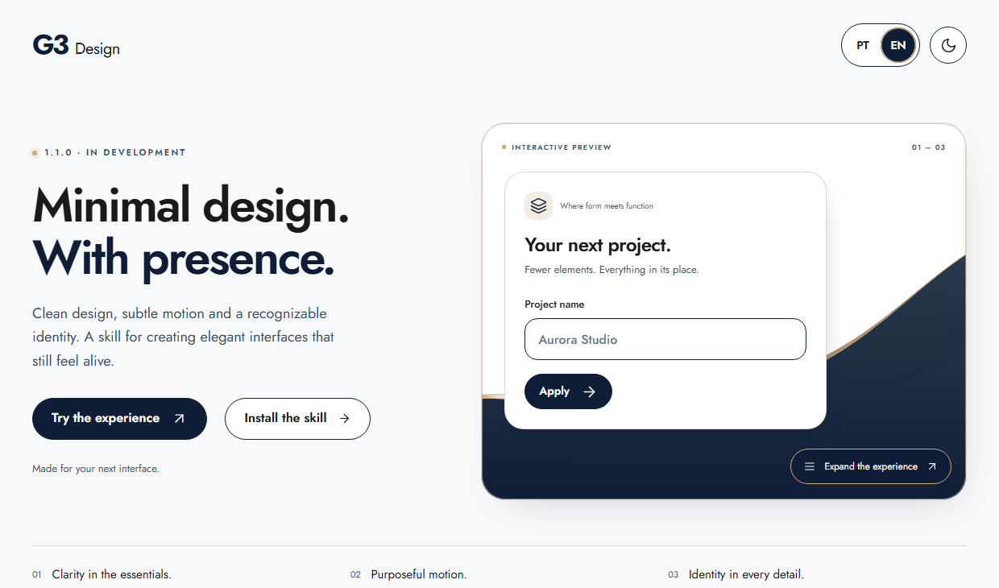

# G3 Design

[Português](README.md) · [English](README.en.md)

[](https://iinask.github.io/g3-design/?lang=en)

## Minimal design. With presence.

Clean components, organic waves and purposeful transitions. G3 Design is a skill for creating elegant interfaces with a recognizable identity.

**Official version 1.1.0 · In active development.** Earlier versions were prototypes.
Instructions and examples may evolve.

**[→ Try the interactive demo](https://iinask.github.io/g3-design/?lang=en)**

Try pointer- and touch-responsive waves, radial button lighting and the travelling PT/EN capsule. Circular transitions contract at the current click. Choose **Corporate, Lavender, Night or Corporate Dark**.

The GitHub README displays a clickable banner. The interactive experience runs on GitHub Pages.

## Install

Requires **Node.js 22.20+**, npm/npx and Git. Run the command in your project folder. It installs the complete skill for the selected agent in that project, without changing global settings.

### Claude Code

```sh
npx --yes skills@1.7.6 add https://github.com/IINasK/g3-design/tree/v1.1.0 --skill g3-design --agent claude-code --copy --yes
```

### Codex

```sh
npx --yes skills@1.7.6 add https://github.com/IINasK/g3-design/tree/v1.1.0 --skill g3-design --agent codex --copy --yes
```

### Cursor

```sh
npx --yes skills@1.7.6 add https://github.com/IINasK/g3-design/tree/v1.1.0 --skill g3-design --agent cursor --copy --yes
```

### Gemini CLI

```sh
npx --yes skills@1.7.6 add https://github.com/IINasK/g3-design/tree/v1.1.0 --skill g3-design --agent gemini-cli --copy --yes
```

### GitHub Copilot

```sh
npx --yes skills@1.7.6 add https://github.com/IINasK/g3-design/tree/v1.1.0 --skill g3-design --agent github-copilot --copy --yes
```

### Antigravity

```sh
npx --yes skills@1.7.6 add https://github.com/IINasK/g3-design/tree/v1.1.0 --skill g3-design --agent antigravity --copy --yes
```

Then ask your agent:

> Use the G3 Design skill. Reuse this project’s components and icons, preserve its identity and audit the result on mobile and desktop.

### Manual installation

Copy the entire [`skills/g3-design`](skills/g3-design/SKILL.md) folder to your agent’s skills directory. Keep its references, assets, examples, scripts and metadata together.

## Update an existing installation

1. Read the version and notes on [Releases](https://github.com/IINasK/g3-design/releases/latest).
2. In your project folder, run the installation command above for your agent again. It is already pinned to **v1.1.0** and preserves copy mode.
3. If the change does not appear, start a new session or restart your AI application.

Save local customizations first: reinstalling replaces the skill files. It does
not automatically change interfaces previously created with the skill. For a ZIP
installation, replace the whole skill folder with the new release's copy.
For a global installation, add `--global`; keep the same installation scope.

`1.7.6` is the installer version; `v1.1.0` in the URL is the G3 Design version.
`main` is development. `skills check`/`skills update` do not, by themselves, select
the latest stable release. Follow this policy by reinstalling the tag listed on
the release. To roll back, use the command or ZIP from the previous version.

See [what changed](CHANGELOG.md) and the [release policy](RELEASING.md).

## What the skill covers

- Consistent fields, borders, spacing, focus and states.
- Reuse of components and licensed official icons.
- Four themes with semantic roles, contrast and coordinated wave colors.
- Included TypeScript/CSS engines for interactive waves, radial light and sliding selectors.
- Responsive layouts, accessible interaction and reduced motion.
- Real-world visual and performance checks.

The target project’s stack, brand and approved components take priority. The skill does not require a specific framework. The demo is an example, not an automatic guarantee of visual quality, security or performance.

## Development and checks

```sh
npm ci
npm run check
npm run test:release
npm run build
npx playwright install chromium
npm run test:demo
python -B skills/g3-design/scripts/validar_pacote.py
python -B -m unittest discover -s tests -p test_validar_pacote.py -v
```

The demo is static HTML/CSS with bundled TypeScript, without runtime framework dependencies. Python 3.9+ is needed for skill checks. Tests use a Node static server bound to the local address.

A real symlink test can be skipped explicitly if the operating system refuses to create it. Browser emulation does not replace physical-device testing.

Technical references: [installer commands](https://github.com/vercel-labs/skills/blob/main/docs/commands.md), [supported agents](https://github.com/vercel-labs/skills/blob/main/docs/agents.md), [font and icon licenses](docs/assets/THIRD-PARTY-NOTICES.md).
