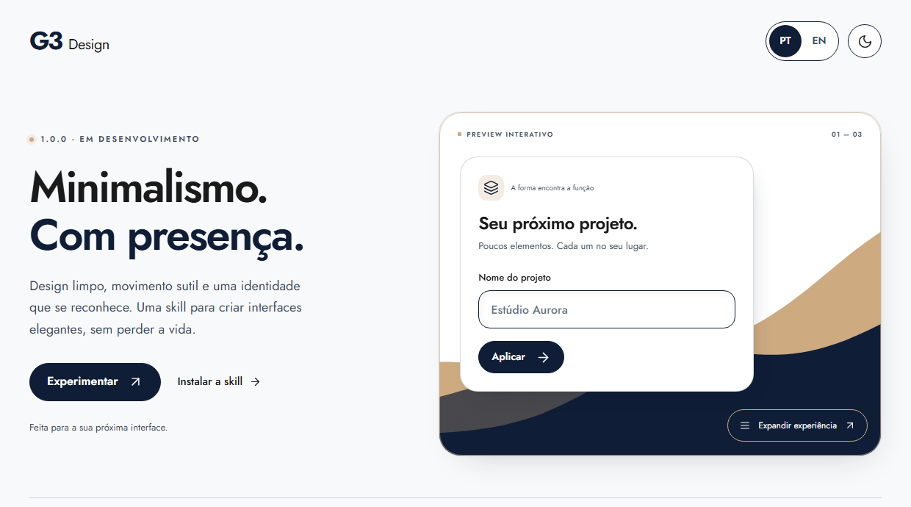

# G3 Design

[Português](README.md) · [English](README.en.md)

[](https://iinask.github.io/g3-design/?lang=pt)

## Minimalismo com presença.

Componentes limpos, ondas orgânicas e transições com intenção. G3 Design é uma skill para criar interfaces elegantes, com uma identidade que se reconhece.

**Versão oficial 1.0.0 · Em desenvolvimento ativo.** As versões anteriores eram protótipos.
As instruções e os exemplos podem evoluir.

**[→ Experimentar a demonstração interativa](https://iinask.github.io/g3-design/?lang=pt)**

Teste o campo editável, o feedback dos botões, os temas claro/escuro e o menu que se expande para outra tela. A demonstração alterna entre português e inglês.

O README do GitHub exibe um banner clicável. A experiência interativa funciona no GitHub Pages.

## Instalar

Requer **Node.js 22.20+**, npm/npx e Git. Execute na pasta do seu projeto. O comando instala a skill completa para o agente escolhido nesse projeto, sem alterar configurações globais.

### Claude Code

```sh
npx --yes skills@1.7.6 add IINasK/g3-design --skill g3-design --agent claude-code --copy --yes
```

### Codex

```sh
npx --yes skills@1.7.6 add IINasK/g3-design --skill g3-design --agent codex --copy --yes
```

### Cursor

```sh
npx --yes skills@1.7.6 add IINasK/g3-design --skill g3-design --agent cursor --copy --yes
```

### Gemini CLI

```sh
npx --yes skills@1.7.6 add IINasK/g3-design --skill g3-design --agent gemini-cli --copy --yes
```

### GitHub Copilot

```sh
npx --yes skills@1.7.6 add IINasK/g3-design --skill g3-design --agent github-copilot --copy --yes
```

### Antigravity

```sh
npx --yes skills@1.7.6 add IINasK/g3-design --skill g3-design --agent antigravity --copy --yes
```

Depois, peça ao agente:

> Use a skill G3 Design. Reutilize os componentes e ícones deste projeto, preserve sua identidade e audite o resultado no celular e no computador.

### Instalação manual

Copie a pasta inteira [`skills/g3-design`](skills/g3-design/SKILL.md) para o diretório de skills do seu agente. Preserve referências, assets, exemplos, scripts e metadados juntos.

## O que a skill orienta

- Campos, bordas, espaçamentos, foco e estados consistentes.
- Reutilização de componentes e ícones oficiais licenciados.
- Temas claro/escuro por papéis semânticos e contraste.
- Responsividade, interação acessível e movimento reduzido.
- Conferência visual e de desempenho no ambiente real.

A stack, a marca e os componentes aprovados no projeto de destino têm precedência. A skill não exige um framework específico. O piloto é um exemplo, não uma garantia automática de qualidade visual, segurança ou desempenho.

## Desenvolvimento e verificação

```sh
npm ci
npm run check
npm run build
npx playwright install chromium
npm run test:demo
python -B skills/g3-design/scripts/validar_pacote.py
python -B -m unittest discover -s tests -p test_validar_pacote.py -v
```

O piloto usa HTML/CSS e TypeScript compilado, sem dependências de framework em execução. Python 3.9+ é usado nas verificações da skill e no servidor local dos testes.

Um teste real de link simbólico pode ser ignorado explicitamente quando o sistema operacional recusar sua criação. Emulação no navegador não substitui teste em aparelho físico.

Referências técnicas: [comandos do instalador](https://github.com/vercel-labs/skills/blob/main/docs/commands.md), [agentes suportados](https://github.com/vercel-labs/skills/blob/main/docs/agents.md), [licenças de fontes e ícones](docs/assets/THIRD-PARTY-NOTICES.md).
